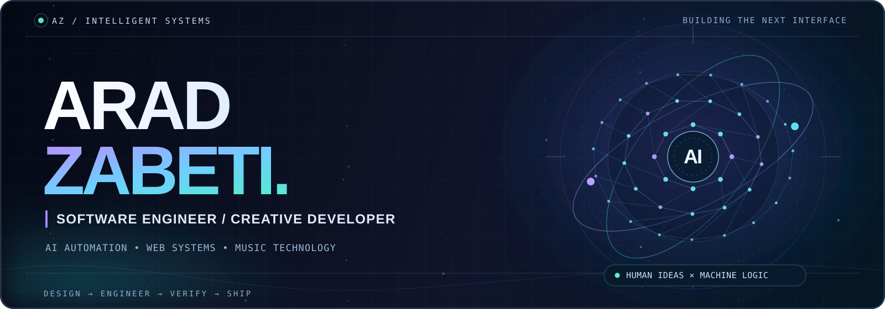
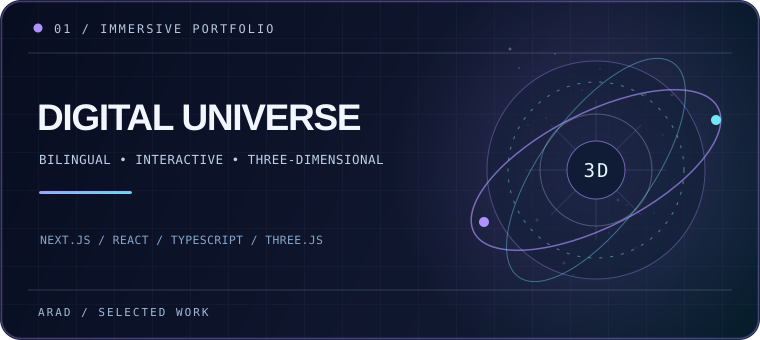
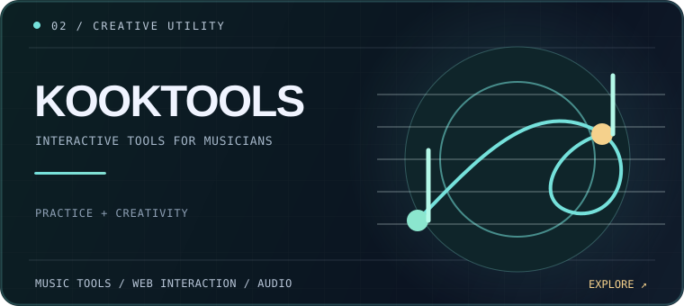
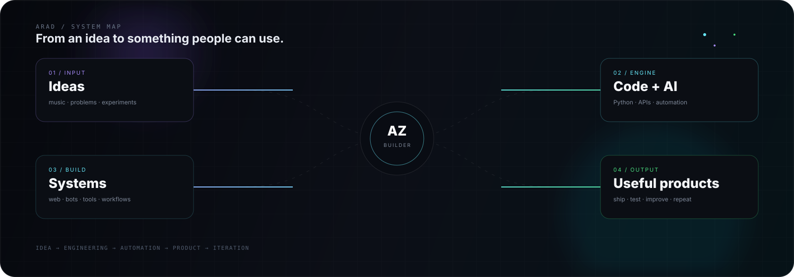

 

### DESIGN-LED ENGINEERING. GROUNDED IN REAL CODE.

**SOFTWARE ENGINEERING &nbsp; / &nbsp; AI AUTOMATION &nbsp; / &nbsp; INTERACTIVE SYSTEMS**

I turn ambitious ideas into usable software — combining reliable application logic, clear interfaces and thoughtful interaction.

Node.js &nbsp; · &nbsp; Python &nbsp; · &nbsp; React &nbsp; · &nbsp; TypeScript &nbsp; · &nbsp; Creative Technology

  <a href="https://aradzabeti.github.io/AradZabeti/"><strong>Explore the portfolio</strong></a>
  &nbsp; · &nbsp;
  <a href="https://aradzabeti.github.io/AradZabeti/fa/"><strong>نسخه فارسی</strong></a>
  &nbsp; · &nbsp;
  <a href="https://aradzabeti.github.io/AradZabeti/resume.html"><strong>View résumé</strong></a>
  &nbsp; · &nbsp;
  <a href="mailto:arad23426@gmail.com"><strong>Get in touch</strong></a>

 

### 00 / THE MISSION

**Build useful systems. Make complexity feel simple.**

I'm interested in the intersection of backend engineering, intelligent automation and expressive frontends. My work spans portfolio experiences, web utilities and practical experiments, with each showcased project tied to source code, a real demo or an explicitly labeled exploration.

| BUILD | CREATE | VERIFY |
|:--|:--|:--|
| APIs, application logic and integrations | Responsive interfaces and interaction | Automated checks, documented behavior and accessibility |

### 01 / SELECTED WORK

<table>
  <tr>
    <td width="50%" valign="top">
      
      <h3><a href="https://aradzabeti.github.io/AradZabeti/">Digital Universe</a></h3>
      A bilingual developer portfolio with interactive 3D, editorial motion, accessible navigation and detailed project studies.
      
<strong>Next.js · React · TypeScript · Three.js</strong>

      <a href="https://aradzabeti.github.io/AradZabeti/">Live experience</a> · <a href="./universe-source/">Source</a>
    </td>
    <td width="50%" valign="top">
      
      <h3><a href="https://kooktools.netlify.app">KookTools</a></h3>
      An interactive, music-focused collection of utilities created to make practice and musical exploration more approachable.
      
<strong>Creative web · Music tools · Interaction</strong>

      <a href="https://kooktools.netlify.app">Visit project</a> · <a href="https://aradzabeti.github.io/AradZabeti/en/projects/kooktools/">Case study</a>
    </td>
  </tr>
</table>

### 02 / INTERACTIVE SYSTEMS LAB

Beyond a static résumé: these are interactive experiences included in the existing portfolio.

<table>
  <tr>
    <td width="33%" valign="top">
      <strong>⌨️ <a href="https://aradzabeti.github.io/AradZabeti/terminal.html">Interactive Terminal</a></strong>
      
A command-driven way to navigate the profile, stack and projects.

    </td>
    <td width="33%" valign="top">
      <strong>◈ <a href="https://aradzabeti.github.io/AradZabeti/os.html">ARAD OS</a></strong>
      
A playful project explorer with a desktop-inspired interface.

    </td>
    <td width="33%" valign="top">
      <strong>✳ <a href="https://aradzabeti.github.io/AradZabeti/studio-luxe.html">Luxury Studio</a></strong>
      
An experimental editorial portfolio with WebGL and refined motion.

    </td>
  </tr>
</table>

### 03 / ENGINEERING STACK

<table>
  <tr>
    <td width="50%" valign="top">
      <strong>01 — Software & Backends</strong>
      
Application logic, APIs, modular components and pragmatic systems.

      <code>Node.js</code> <code>Python</code> <code>REST APIs</code> <code>Git</code>
    </td>
    <td width="50%" valign="top">
      <strong>02 — Interactive Frontends</strong>
      
Thoughtful interfaces, responsive layouts, motion and accessibility.

      <code>React</code> <code>Next.js</code> <code>TypeScript</code> <code>Three.js</code>
    </td>
  </tr>
  <tr>
    <td width="50%" valign="top">
      <strong>03 — Automation & AI</strong>
      
Connecting services, messaging tools, webhooks and useful AI workflows.

      <code>Python</code> <code>Webhooks</code> <code>AI APIs</code> <code>Telegram</code>
    </td>
    <td width="50%" valign="top">
      <strong>04 — Music Technology</strong>
      
Where my interest in music meets practical and creative software.

      <code>Web Audio</code> <code>MIDI</code> <code>Creative Tools</code>
    </td>
  </tr>
</table>

  

### 04 / SYSTEMS THINKING

**My approach:** Understand the problem → prototype what matters → build cleanly → polish the interaction → ship and learn.

I care about **what the product does** just as much as **how it feels to use**. Good software should be maintainable behind the scenes and effortless at the surface.

### 05 / SOURCE, PROOF & MAINTENANCE

This profile repository includes the Digital Universe source, the published static site, experimental pages and technical documentation. The visual identity is intentionally built from lightweight local SVGs, with no external scripts embedded in the artwork.

- **[Portfolio source](./universe-source/)** — Next.js, React, TypeScript and Three.js.
- **[Architecture & technical notes](./docs/ARCHITECTURE.md)** — repository structure and deployment boundaries.
- **[Futuristic AI design system](./docs/FUTURISTIC_AI_DESIGN.md)** — colors, typography, accessibility and visual identity.
- **[Project repository](https://github.com/AradZabeti/AradZabeti)** — code, issues and revision history.
- **[Automated checks](./.github/workflows/)** — source build, TypeScript verification and site integrity.

<strong>↳ GitHub activity (live third-party cards)</strong>

 

  
  

Statistics are provided by an external service and may not always be available.

### BUILD WITH INTENTION. SHIP WITH CONFIDENCE.

**Have a technical challenge, an idea or a thoughtful collaboration in mind?**

<a href="mailto:arad23426@gmail.com"><strong>Email me</strong></a> &nbsp; · &nbsp;
<a href="https://github.com/AradZabeti"><strong>GitHub</strong></a> &nbsp; · &nbsp;
<a href="https://aradzabeti.github.io/AradZabeti/"><strong>Portfolio</strong></a>

 

Design × Engineering × Verification — Arad Zabeti

